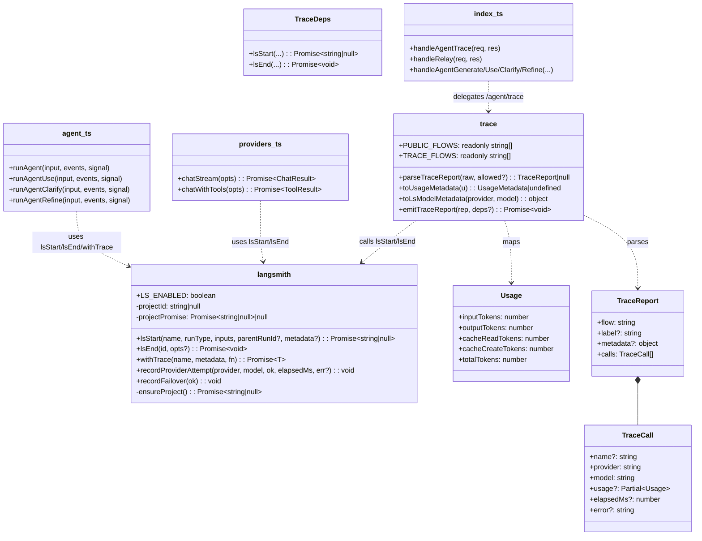
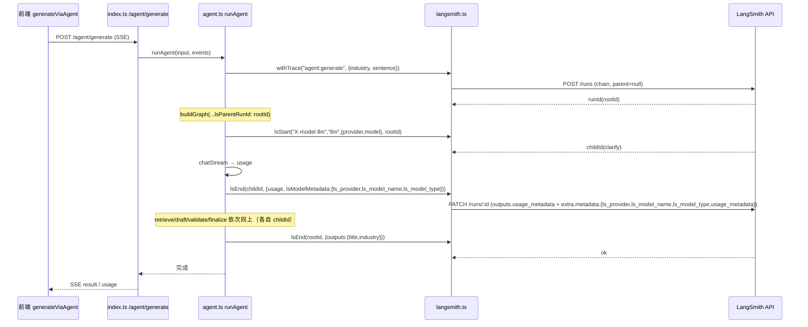
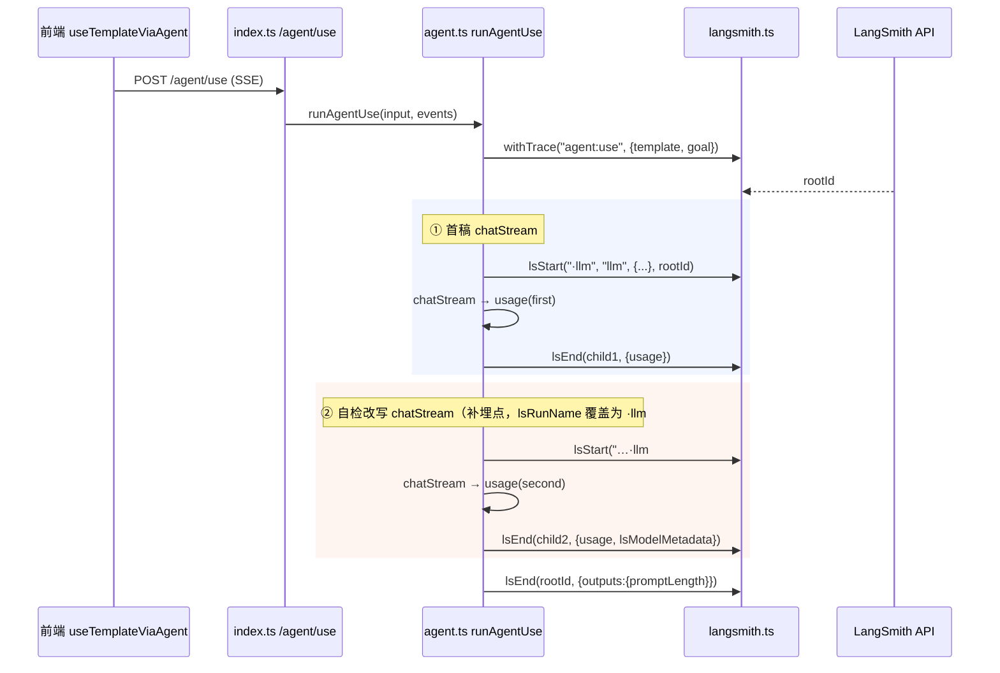
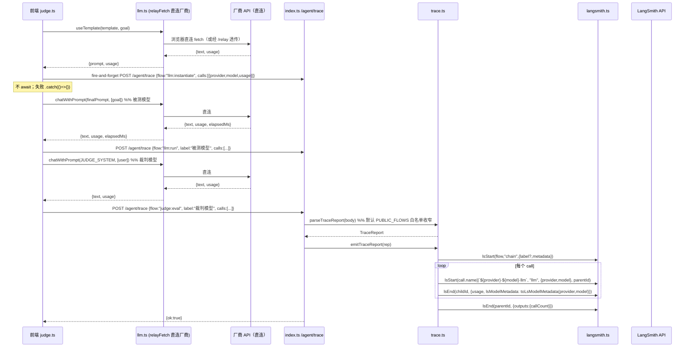
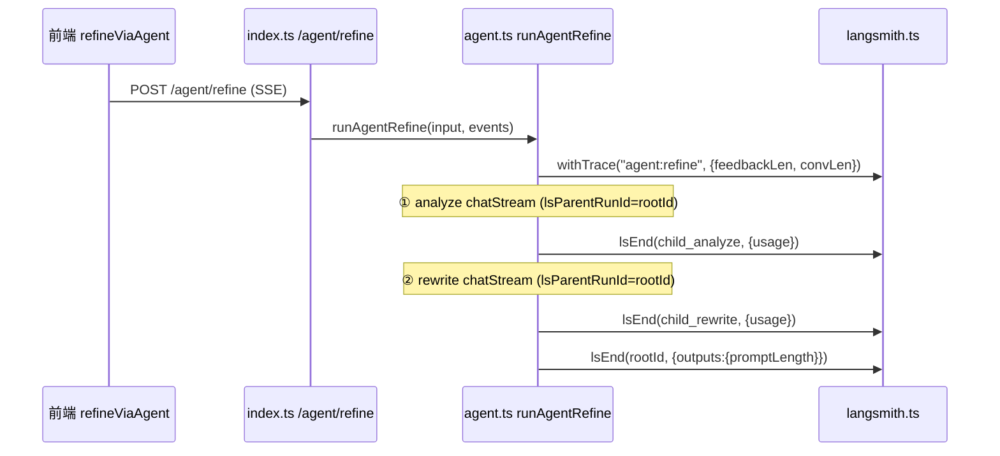
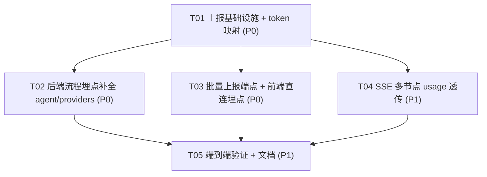

# 系统设计：LangSmith 链路追踪恢复 + token 统计增强

> 项目：模法师·Promptly（个人本地版）
> 技术栈：Vite + TS 前端（`site/src`）· Node 22 TS 后端（`site/server`，:8000）
> 类型：**增量设计**（项目已有代码，最小变更、可关可开、默认零开销）
> 作者：高见远（架构师）

---

## Part A：系统设计

### 1. 实现方案与选型

#### 1.1 核心问题拆解

| # | 问题 | 现状 | 目标 |
|---|------|------|------|
| P1 | 上报层被裁成空壳 | `langsmith.ts` 24 行 no-op | 恢复真实上报，且**可关可开** |
| P2 | token 被 LangSmith 忽略 | usage 塞在 `extra.metadata.usage`（平台不读该路径） | token → **`outputs.usage_metadata`**（并双写 `extra.metadata.usage_metadata`）；成本 → **`extra.metadata.ls_provider` + `ls_model_name`** |
| P3 | F39 改写链路无 trace | `runAgentRefine` 无 `withTrace` | 加父 chain + 子 llm 层级 |
| P4 | 前端直连厂商链路零 trace | `relayFetch` 浏览器直连厂商 | 通过**后端批量上报端点**补埋点 |
| P5 | 节点级 usage 被覆盖 | `usage` 事件只取最后一个 | 落 LangSmith 按节点独立 lineage |

#### 1.2 关键决策一：如何让 LangSmith 正确识别 token（P2）

> ⚠️ **踩坑警示**：早期设计稿曾写「输入 token 写 `extra.invocation_params`」。**该字段无效——LangSmith 平台根本不读取 `extra.invocation_params`**。我们在实现中查证了 `node_modules/langsmith@0.8.6` 源码与官方文档，正确落点如下。后人请勿再写该字段。

LangSmith 的 **Token 统计列与成本估算**只读 run 的固定位置，不看我们自定义的 `extra.metadata.usage`：

- **token 统计**：读 **`outputs.usage_metadata`**（官方「Return usage_metadata in the output」路径），结构必须是
  `{ input_tokens: number, output_tokens: number, total_tokens: number }`
  （可再带 `input_token_details.cache_read` / `cache_creation` 映射 cache 命中）。
  实现中**额外双写一份到 `extra.metadata.usage_metadata`**——SDK 的 anthropic 路径即写此处（`dist/experimental/anthropic/context.cjs:456-464`），双写覆盖更稳。
- **成本估算（必需）**：`extra.metadata.ls_provider` + `extra.metadata.ls_model_name`（另加 `ls_model_type: "chat"`）。
  官方文档（docs.langchain.com/langsmith/log-llm-trace）明确四条件：① `run_type="llm"` ② inputs/outputs 用标准消息格式 ③ **`ls_provider` + `ls_model_name` 放 `metadata`**（缺 `ls_model_name` → token 可能仍记录，但 **cost 不会估算**）④ token 用 `usage_metadata`。
  官方 openai wrapper（`dist/wrappers/openai.cjs:257-262`）即返回 `{ ls_provider, ls_model_type, ls_model_name, ls_invocation_params }`，经 `traceable.cjs:245-251` 的 `getInvocationParams` 写入 `runTree.extra.metadata`。

因此 `lsEnd` 需把内部 `Usage` 结构**规范化映射**到 LangSmith 期望字段：

```
内部 Usage {inputTokens, outputTokens, cacheReadTokens, cacheCreateTokens, totalTokens}
  │
  ├─ outputs.usage_metadata              ← { input_tokens, output_tokens, total_tokens,
  │                                          input_token_details:{cache_read, cache_creation} }   // token 统计读取源
  └─ extra.metadata.usage_metadata        ← 同一份 usage_metadata 双写（SDK anthropic 路径即写此处）
  └─ extra.metadata.ls_provider/ls_model_name/ls_model_type ← 成本估算必需（缺 ls_model_name → 不计成本）
```

> 实际代码中，`lsEnd` 的 `lsModelMetadata` 参数承载 `{ ls_provider, ls_model_type, ls_model_name }`（由 `trace.toLsModelMetadata(provider, model)` 构造），并与上游 `metadata` 合并后写入 `extra.metadata`（`ls_*` 放后即优先生效）。

**真实平台端到端验证**（上报后反查 LangSmith API，llm 类型 run 返回）：

```json
{
  "run_type": "llm",
  "total_tokens": 1801, "prompt_tokens": 1234, "completion_tokens": 567,
  "total_cost": 0.0003178, "prompt_cost": 0.00015904, "completion_cost": 0.00015876,
  "price_model_id": "ff85936f-b19f-4dc3-bd88-ebb30dc1451b",
  "extra_metadata": {
    "ls_provider": "deepseek", "ls_model_name": "deepseek-chat", "ls_model_type": "chat",
    "usage_metadata": {
      "input_tokens": 1234, "output_tokens": 567, "total_tokens": 1801,
      "input_token_details": { "cache_read": 100, "cache_creation": 0 }
    }
  }
}
```

> ⚠️ **层级关系（勿误判）**：**chain 类型 run 的顶层 `total_tokens` 恒为 0 属正常**——token 落在其**子 llm run** 上。`agent:*` 父 chain 只承载编排结构，真正的用量在子 llm run。因此看用量要展开子 run，或按 flow 汇总子 llm run。

> **兼容策略**：`lsEnd` 增补字段时**保留**原有 `outputs` 与 `extra.metadata`（旧可视化），只做**追加**（`outputs.usage_metadata` 合并进 outputs；`extra.metadata` 合并 `ls_*` 与 `usage_metadata`）。写入为「有则补、无则略」，绝不抛错。

#### 1.3 关键决策二：前端直连链路怎么覆盖（P4）— 走服务端批量上报端点

两条候选路径的取舍：

| 方案 | A. 后端新增批量上报端点（推荐） | B. 浏览器直接 POST LangSmith |
|------|-------------------------------|------------------------------|
| Key 暴露 | ✅ 留在服务端 `.env`，不进浏览器 | ❌ API Key 必须下发到浏览器，泄露 |
| CORS | ✅ 同源调用本地后端 | ❌ LangSmith 不保证 CORS，浏览器大概率被拦 |
| 失败影响 | ✅ fire-and-forget，失败静默 | ❌ 直连失败可能污染主链路 |
| 可控性 | ✅ 单点开关、单点限流/去重 | ❌ 分散在多个前端函数 |
| 依赖 | 复用现有裸 fetch | 无 |

**结论：选 A**。后端新增 `POST /agent/trace`（**无状态、fire-and-forget、不承接主数据流**），前端在**已拿到 usage / elapsedMs 之后**异步上报，形如 `fetch("/agent/trace", {...}).catch(()=>{})`，**绝不 await、绝不阻塞 UI**，失败静默。

> **架构级硬约束（不是可选项）**：`index.ts:buildCsp()` 的 `connect-src` 白名单 = `'self'` + 各厂商域名，**不含 LangSmith** → 浏览器**根本无法直连 LangSmith 上报**。故「经本机后端中转」是前端直连链路**唯一可行路径**（强行把 LangSmith 加进 `connect-src` 等于把上报口暴露给浏览器且需下发 Key，破坏安全模型）。

上报内容对前端**去厂商化**：前端只说「我做了哪个流程、用了哪个 provider/model、花了多少 token、耗时多久」，**不传 Prompt 正文、不传 Key、不传厂商原始响应**（隐私 + 体积）。服务端据此构造 LangSmith run 树（父 chain=流程名，子 llm=模型调用）。

#### 1.4 关键决策三：开关语义（P1）

保留 `LS_ENABLED` 导出名（调用点已引用）但升级判定逻辑：

```
LS_ENABLED = LANGSMITH_ENABLED ? (值==="1"/"true")     // 显式开关优先
                              : !!LANGSMITH_API_KEY;   // 未设置时按有无 Key 自动判断
```

- 用户可 `LANGSMITH_ENABLED=0` **强制关闭**（即便有 Key）。
- 无 Key → 全部 no-op，**零开销**（与现状行为一致）。
- 所有上报函数**双重保险**：`if (!LS_ENABLED) return null/void` **且** 全程 `try/catch` 吞异常。

#### 1.5 架构模式

沿用现有「**函数式 + 模块级单例状态**」风格（无类、无框架）。新增一个 **纯函数工具层 + 一个无状态 HTTP 端点**，不引入任何新依赖、不改动主数据流。

- `langsmith.ts`：同步/异步上报原语（裸 `fetch`），保持 side-effect-free 的失败语义。
- `trace.ts`（新增）：把「内部 Usage → LangSmith 期望字段」的映射、前端上报体的校验与 run 树构造抽成**可单测的纯函数**。
- `index.ts`：仅挂一个新路由 `POST /agent/trace`，逻辑全部委托 `trace.ts`。

#### 1.6 技术挑战与对策

| 挑战 | 对策 |
|------|------|
| 无 Key / 断网 / LangSmith 抖动不得拖慢主链 | 所有上报 `await` 点仅出现在**已有 await 的收尾处**；前端上报**完全不 await**；双重 try/catch |
| `ensureProject()` 并发重复建项目 | 模块级 `projectId` 缓存 + 进行中 Promise 去重（in-flight memo） |
| Node 22 `crypto.randomUUID` | 用 `globalThis.crypto.randomUUID()`，Node 18+ 内置，无需 import |
| 中文项目名 / endpoint 末尾斜杠 | 沿用原实现 `.replace(/\/$/, "")`；项目名原样传（JSON body，无编码问题） |
| 批量上报被滥用/放大 | 端点做**白名单校验**（`parseTraceReport` 仅接受约定流程名与字段），多余字段丢弃；异常恒回 `{ok:true}`，前端不重试 |

---

### 2. 文件列表

| # | 相对路径 | 动作 | 一句话说明 |
|---|----------|------|-----------|
| F1 | `site/server/src/langsmith.ts` | **改写** | 恢复真实上报（裸 fetch），新增 token 字段映射、显式开关、`lsStart/lsEnd/withTrace/recordProviderAttempt/recordFailover` 完整签名 |
| F2 | `site/server/src/trace.ts` | **新增** | 纯函数工具：Usage→LangSmith 映射、前端 trace 上报体 schema 校验、按流程构造 run 树 |
| F3 | `site/server/src/index.ts` | **修改** | 挂载 `POST /agent/trace` 无状态端点；`/relay` 保持不动（可选用最小方式记录 relay 流程用量，见 §7 待定项） |
| F4 | `site/server/src/agent.ts` | **修改** | 为 `runAgentRefine` 加 `withTrace("agent:refine", …)` 父 run，并给两次 `chatStream` 传 `lsParentRunId`（P3） |
| F5 | `site/server/src/providers.ts` | **修改** | 打通「普通 `chatStream`」也建子 llm run（现仅 `chatWithTools` 建）；结束传标准 usage 字段 |
| F6 | `site/src/llm.ts` | **修改** | 新增 `reportTrace()` / `reportCall()` 前端上报助手（不 await/不抛）；在直连/代理取得 usage 的收尾处调用（`chatWithPrompt/useTemplate/optimizePrompt/runPrompt/generateTemplate/prodSelfCheck/refinePromptDirect`）；为可被评测评链复用的 `useTemplate`/`chatWithPrompt` 加 `skipReport` 开关（第 7/第 6 参） |
| F7 | `site/src/core/judge.ts` | **修改** | F13 评测三步（`llm:instantiate` / `llm:run` / `judge:eval`，label 实例化/被测模型/裁判模型）各 `LLM.reportTrace` 一条 trace，均带 `from:"judge"`；调用时 `skipReport=true` 避免双报 |
| F8 | `site/server/tests/trace.test.ts` | **新增** | 离线单测：Usage→LangSmith 映射、上报体校验、无 Key 时 no-op（零网络） |
| F9 | `site/server/.env.example` | **修改** | 补充 `LANGSMITH_ENABLED` 说明与用法（`.env` 本身被 gitignore，不改真实值） |

> 不改动：`site/server/.env`（已有有效 Key，gitignore 安全）、`package.json`（**不引入 langsmith SDK**）。

---

### 3. 数据结构与接口

#### 3.1 `langsmith.ts` 最终导出签名

```ts
// 开关：显式优先，其次按 Key 自动判断
export const LS_ENABLED: boolean;

// 创建 run；失败/未启用返回 null（调用方无需关心）
export async function lsStart(
  name: string,
  runType: "chain" | "llm" | "tool",
  inputs: unknown,
  parentRunId?: string | null,
  metadata?: Record<string, unknown>,
): Promise<string | null>;

// 结束 run；id 为空/null 直接 return。token 由 opts.usage 传入并映射到标准字段
export async function lsEnd(
  id: string | null,
  opts?: {
    outputs?: unknown;
    error?: string;
    metadata?: Record<string, unknown>;
    usage?: Usage;                          // 内部 Usage → 映射为 outputs.usage_metadata（并双写 extra.metadata.usage_metadata）
    lsModelMetadata?: Record<string, unknown>; // ★成本估算必需：{ ls_provider, ls_model_type, ls_model_name }，由 toLsModelMetadata() 构造，合并进 extra.metadata
    model?: string;                         // 便捷字段（当前实现保留位，实际成本元数据走 lsModelMetadata）
  },
): Promise<void>;

// 便捷包裹：父 chain run，异常时结 error 并 rethrow
export async function withTrace<T>(
  name: string,
  metadata: Record<string, unknown>,
  fn: (rootId: string | null) => Promise<T>,
): Promise<T>;

// 厂商尝试 / 主备切换埋点：进程级运维遥测（parent=null，不归属任何流程 run），fire-and-forget
export function recordProviderAttempt(
  provider: string, model: string, ok: boolean, elapsedMs: number, err?: string,
): void;
export function recordFailover(ok: boolean): void;
```

> **⚠️ 有效 / 无效字段对照（勿再写错）**
> - ✅ token 统计：`outputs.usage_metadata`（+ 双写 `extra.metadata.usage_metadata`）
> - ✅ 成本估算：`extra.metadata.ls_provider` / `ls_model_name` / `ls_model_type`
> - ❌ **`extra.invocation_params` 无效——平台不读取**（早期设计稿误写此处）

**run 字段规范表**（与 `langsmith.ts` / `trace.ts` 实际实现一致）

| 字段 | chain（父，一个流程） | llm（子，一次模型调用） | tool（运维遥测） |
|------|----------------------|------------------------|-----------------|
| `run_type` | `"chain"` | `"llm"` | `"tool"`（provider 尝试 / failover 记录） |
| `name` | 流程名：前端 9 个 + 后端 4 个（见 §3.3 / §4 命名规范） | `${providerLabel}·${model}·llm`（重试追加 `#2/#3` 后缀；可用 `opts.lsRunName` 覆盖，如 `…·llm#selfcheck`） | `${provider}·${model}·attempt` / `llm:failover` |
| `inputs` | 流程入参摘要（**脱敏**：不含 Key/Prompt 正文） | `{ provider, model }` | `{ provider, model }` / `{ ok }` |
| `outputs` | 结构化结果摘要（`callCount` / title/industry/promptLength…） | `{ elapsedMs, textLength }` + **`usage_metadata`** | `{ ok, elapsedMs }` |
| `extra.metadata` | 流程元数据（industry/template/goal…） | **`ls_provider`/`ls_model_name`/`ls_model_type`（成本必需）** + `provider`/`model` + 双写 `usage_metadata` | `{ provider, model, ok, elapsedMs }` |
| `error` | 失败消息 | 失败消息 | 失败消息 |
| `parent_run_id` | 通常 `null`（顶层流程） | 指向父 chain run | **恒 `null`**（进程级遥测，不归属具体流程） |

> **层级提醒**：chain run 顶层 `total_tokens` 恒为 0；token 全在子 llm run 上（见 §1.2 实证）。

**Usage → LangSmith 映射（`trace.toUsageMetadata`，核心）**

```ts
// outputs.usage_metadata（LangSmith token 列读取源）+ 双写 extra.metadata.usage_metadata
{
  input_tokens:  usage.inputTokens,
  output_tokens: usage.outputTokens,
  total_tokens:  usage.totalTokens || (input+output+cacheRead+cacheCreate),
  input_token_details: { cache_read: cacheReadTokens, cache_creation: cacheCreateTokens }
}

// trace.toLsModelMetadata(provider, model) → 写入 extra.metadata（成本估算必需）
{ ls_provider: provider, ls_model_type: "chat", ls_model_name: model }
```
> 写入策略：`usage` 存在时写 `usage_metadata`（「有则补、无则略」）；llm run 恒写 `ls_*` 成本元数据。

#### 3.2 新增后端端点：`POST /agent/trace`

**用途**：前端直连厂商链路（不经后端）的用量补报。**无状态、fire-and-forget、可静默失败。**

**请求体 JSON Schema**

```json
{
  "$schema": "http://json-schema.org/draft-07/schema#",
  "type": "object",
  "required": ["flow", "calls"],
  "properties": {
    "flow": {
      "type": "string",
      "enum": ["judge:eval", "llm:instantiate", "llm:run", "llm:optimize",
               "llm:refine-direct", "llm:generate-template", "llm:prod-selfcheck",
               "llm:preview", "llm:chat"]
    },
    "label": { "type": "string", "description": "展示名，如 裁判模型/被测模型" },
    "metadata": { "type": "object", "description": "脱敏摘要，如 {industry, goalLen}" },
    "calls": {
      "type": "array",
      "minItems": 1,
      "items": {
        "type": "object",
        "required": ["provider", "model"],
        "properties": {
          "name":     { "type": "string" },
          "provider": { "type": "string" },
          "model":    { "type": "string" },
          "usage": {
            "type": "object",
            "properties": {
              "inputTokens":  { "type": "number" },
              "outputTokens": { "type": "number" },
              "cacheReadTokens":   { "type": "number" },
              "cacheCreateTokens": { "type": "number" },
              "totalTokens":  { "type": "number" }
            }
          },
          "elapsedMs": { "type": "number" },
          "error":     { "type": "string" }
        }
      }
    }
  }
}
```

**响应**

```json
{ "ok": true }                 // 200：已受理（无论 LangSmith 是否成功，避免前端重试放大）
{ "ok": false, "error": "无效 JSON" }                              // 400：非法 JSON
{ "ok": false, "error": "非法 trace 上报体（flow 白名单或 calls 校验失败）" } // 400：校验失败
```

**服务端处理契约**（`index.ts:handleAgentTrace` 实际实现）
1. 未启用（`!LS_ENABLED`）→ **`req.resume()` 排空请求体 + 立即 `sendJSON(res,200,{ok:true})`**，不解析 body、不建任何 run、不发任何网络请求（零开销）。
   > `req.resume()` 是**纯 socket 卫生**：keep-alive 连接若不读 body 会被复用出问题；无任何副作用。
2. `JSON.parse` 失败 → **400** `{ok:false, error:"无效 JSON"}`。
3. `parseTraceReport(body)`（默认 **PUBLIC_FLOWS 收窄白名单**）返回 null → **400** `{ok:false, error:"非法 trace 上报体…"}`。
4. 合法 → `await emitTraceReport(rep)`（1 条父 chain run + 每个 call 1 条子 llm run，带 usage）。
5. **任何异常兜底回 200 `{ok:true}`**——埋点永不向调用方报错；`emitTraceReport` 内部已 try/catch，端点再包一层双保险。
6. 仅接受白名单 `flow` 与约定字段，多余字段一律丢弃。

> **`await` 取舍**：本端点选择 `await emitTraceReport(...)` 后整体 try/catch（而非纯 fire-and-forget）。理由：本地单机、单次量小，await 让「LangSmith 上何时出现 run」更可预期；前端 `reportTrace` 本身绝不 await，故不拖慢任何 UI 时序。

**架构级约束：CSP `connect-src` 不含 LangSmith**
`index.ts:buildCsp()` 的 `connect-src` 白名单 = `'self'` + 各 `PROVIDERS` 的厂商域名 origin（用于「浏览器直连厂商」模式 + XSS 外泄收口）。**LangSmith 域名不在白名单** → **浏览器无法直连 LangSmith 上报** → 前端直连链路**唯一可行路径就是经本机后端 `/agent/trace` 中转**。这不是可选项，是**架构级约束**（若强行把 LangSmith 加进 `connect-src`，则等于把上报口暴露给浏览器且需下发 Key，反而破坏安全模型）。

#### 3.3 `trace.ts` 纯函数接口（可单测）

```ts
export interface TraceCall {
  name?: string; provider: string; model: string;
  usage?: Partial<Usage>; elapsedMs?: number; error?: string;
}
export interface TraceReport {
  flow: string; label?: string;
  metadata?: Record<string, unknown>; calls: TraceCall[];
}
export interface UsageMetadata {
  input_tokens: number; output_tokens: number; total_tokens: number;
  input_token_details?: { cache_read: number; cache_creation: number };
}

// 流程白名单（收窄机制的核心）
export const PUBLIC_FLOWS: readonly string[];  // 9 个前端可上报流程（端点默认白名单）
export const TRACE_FLOWS: readonly string[];   // 13 个 = PUBLIC_FLOWS + 4 个 agent:*（后端内部复用）

// 校验上报体，返回规范化结果或 null（非法）。allowed 默认 PUBLIC_FLOWS；
// 后端内部复用时可传 TRACE_FLOWS（含 agent:* 流程名）。
export function parseTraceReport(raw: unknown, allowed?: readonly string[]): TraceReport | null;

// 内部 Usage → outputs.usage_metadata（LangSmith token 列读取源）；total 缺失时兜底。
export function toUsageMetadata(u: Partial<Usage> | undefined): UsageMetadata | undefined;

// 构造 LangSmith 成本元数据 → 写入 extra.metadata（成本估算必需）。
// 返回 { ls_provider, ls_model_type:"chat", ls_model_name }。
// 注意：函数名为 toLsModelMetadata（不再有 toInvocationParams —— 那个字段无效）。
export function toLsModelMetadata(provider: string, model: string): Record<string, unknown>;

// 把一条上报落成 run 树（1 父 chain + 每 call 1 子 llm）；deps 可注入以便离线单测。
export async function emitTraceReport(rep: TraceReport, deps?: TraceDeps): Promise<void>;

// 上报原语依赖接口；默认动态 import langsmith.ts 绑定真实实现，单测注入替身。
export interface TraceDeps {
  lsStart: (name: string, runType: "chain" | "llm" | "tool",
            inputs: unknown, parentRunId?: string | null,
            metadata?: Record<string, unknown>) => Promise<string | null>;
  lsEnd: (id: string | null, opts?: {
            outputs?: unknown; error?: string; metadata?: Record<string, unknown>;
            usage?: Usage; lsModelMetadata?: Record<string, unknown>; model?: string;
          }) => Promise<void>;
}
```

> **白名单收窄机制**：`parseTraceReport` 的 `allowed` 参数使同一个纯函数既能服务对外端点（PUBLIC_FLOWS，**拒绝** `agent:*`，因为 SSE 链路由后端直接上报，前端不得伪造），又能服务后端内部（TRACE_FLOWS）。`emitTraceReport` 默认通过 `dynamic import("./langsmith.js")` 取 deps，避免测试环境（无 Key）在模块顶层触发副作用。

**`emitTraceReport` 构造的 run 树细节（与实现一致）**
- 父 chain run：`name = rep.flow`，`inputs = { label?, metadata }`，`extra.metadata = rep.metadata`。
- 每个 call 的子 llm run：`name = call.name || \`${provider}·${model}·llm\``，`inputs = {provider, model}`，`extra.metadata = {provider, model}`。
- 子 run 结束：`lsEnd(childId, { outputs: call.error ? undefined : {elapsedMs}, error: call.error, usage: call.usage, lsModelMetadata: toLsModelMetadata(provider, model) })`。
- 父 run 结束：`lsEnd(parentId, { outputs: { callCount: rep.calls.length } })`。
- 全过程 try/catch，埋点失败静默。

#### 3.4 类图（服务/数据结构关系）



#### 3.5 13 个上报流程清单与分工原则

| 归属 | flow 名 | 上报位置（代码） | 说明 |
|------|---------|-----------------|------|
| 后端 SSE | `agent:generate` | `agent.ts:263` `withTrace`（runAgent） | F1 生成 |
| 后端 SSE | `agent:use` | `agent.ts:337` `withTrace`（runAgentUse） | F2 代写 |
| 后端 SSE | `agent:clarify` | `agent.ts:494` `withTrace`（runAgentClarify） | F3 澄清 |
| 后端 SSE | `agent:refine` | `agent.ts:591` `withTrace`（runAgentRefine） | F39 编辑器增强改写 |
| 前端直连 | `llm:generate-template` | `llm.ts` `generateTemplate` → `reportCall` | 生成模板 |
| 前端直连 | `llm:prod-selfcheck` | `llm.ts` `prodSelfCheck` → `reportCall` | 生产自检 |
| 前端直连 | `llm:instantiate` | `llm.ts` `useTemplate`（非 judge 语境）→ `reportCall`；F13 由 `judge.ts:75` 带 `from:"judge"` 上报 | 模板实例化 |
| 前端直连 | `llm:preview` | `llm.ts` 示例预览链路 | 示例预览 |
| 前端直连 | `llm:chat` | `llm.ts` `chatWithPrompt`（非 judge 语境）→ `reportCall` | 测试沙盒对话 |
| 前端直连 | `llm:refine-direct` | `llm.ts` `refinePromptDirect` → `reportCall` | 直连回退改写 |
| 前端直连 | `llm:optimize` | `llm.ts` `optimizePrompt` → `reportCall` | F13 优化改写 |
| 前端直连 | `llm:run` | `llm.ts` `runPrompt` → `reportCall`；F13 由 `judge.ts:85` 带 `from:"judge"` 上报 | 在线试跑 |
| 前端直连 | `judge:eval` | `judge.ts:93` `LLM.reportTrace`（label「裁判模型」） | F13 裁判打分 |

- 前端 9 个 = `trace.PUBLIC_FLOWS`（`/agent/trace` 端点白名单）。
- 后端 4 个 `agent:*` 由后端 `withTrace` 直接上报；**前端对这些流程一律不报**（否则重复计数）。
- 全量 13 个 = `trace.TRACE_FLOWS`（供后端内部复用）。

**分工原则（防重复计数）**
- **SSE 链路（`agent:*`）**：token 由**后端**带 `lsParentRunId` 建的**子 llm run** 承载，前端**不上报**。
- **前端直连链路**：由前端 `reportTrace()` 经 `/agent/trace` 中转，**父 chain = flow 名**，**子 llm = 每次调用**。
- 同一次模型调用**只在一个层级上报一次**，避免双计。

#### 3.6 防重复上报机制：`skipReport` 开关

**问题**：F13 评测链路内部会调用 `useTemplate` / `chatWithPrompt`，这些函数默认**自报** `llm:instantiate` / `llm:chat`。但评测调用方（`judgeSample`）需要带**评测语境**（`from:"judge"`、跨厂商归因、label「实例化/被测模型/裁判模型」）**统一上报**。若两处都报，同一份 usage 被记两次 → **token 统计虚高**。

**设计**：可被评测评链复用的 LLM 调用函数**必须提供 `skipReport` 开关**，供调用方关闭内部自报、改由自己统一上报：
- `useTemplate(template, goal, onToken, signal, selfCheck, onStage, skipReport)`（第 7 参）
- `chatWithPrompt(promptText, messages, onToken, signal, over, skipReport)`（第 6 参）
- `judge.ts` 调用时传 `skipReport=true`，随后 `judge.ts:75/85/93` 用 `LLM.reportTrace` 带 `from:"judge"` 各自上报。

> ⚠️ **易错点（维护者必读）**：**新增任何「可能被评测评链复用」的 LLM 调用函数时，必须提供 `skipReport` 开关**，否则评测语境会混入一条无 `from:"judge"` 的重复用量。
> 已知未修耦合：`prodSelfCheck` 内部会自报 `llm:prod-selfcheck`，**且不受 `skipReport` 约束**（`llm.ts:514` 有注释标记）。若某天 judge 语境走到 `selfCheck=true`，需给 `prodSelfCheck` 也补 `skipReport` 开关。（当前 judge 路径未触发，暂不修。）

---

### 4. 程序调用流程（时序图）

#### 4.1 F1 生成（后端 Agent，含节点级 token）



> **要点**：每个节点对应一条独立子 llm run，token 按节点归属，LangSmith 的 Usage 面板即可按 run 名（clarify/draft/…）拆分统计。

#### 4.2 F2 代写（后端，首稿 + 自检改写两次调用）



#### 4.3 F13 评测（前端直连 → 批量上报端点）



> **要点**：F13 三步各上报一条**带 label 的 trace**（`llm:instantiate`「实例化」/ `llm:run`「被测模型」/ `judge:eval`「裁判模型」），均带 `from:"judge"` 语境，解决"裁判跨厂商自评偏差"场景下的用量分辨问题。三步内部调用的 `useTemplate`/`chatWithPrompt` 均传 `skipReport=true`（见 §3.6），避免双报虚高。

#### 4.4 F39 改写（补齐缺失的 trace，P3）



---

## Part B：任务分解

### 6. 所需依赖包

**新增第三方依赖：无。**

- 继续使用 **裸 `fetch`** 上报 LangSmith（原实现方式），**不引入 `langsmith` SDK**（虽已在 node_modules 作为传递依赖，但显式加依赖会扩大依赖面与构建风险）。
- 复用现有：Node 22 内置 `fetch` / `globalThis.crypto.randomUUID` / `node:test` / `node:assert/strict`。
- 前端零新增依赖（仅封装 `fetch`）。

```
（无 package.json 变更）
```

### 7. 任务列表（有序，按依赖）

> 硬性上限 5 个任务；每个任务 ≥3 个相关文件；第一个任务为「上报基础设施」。T02–T04 仅依赖 T01，彼此可并行。

---

#### **T01 · 上报基础设施恢复 + token 映射（核心）** — P0

**Source Files**
- `site/server/src/langsmith.ts`（改写：恢复真实实现 + 显式开关 + token 标准字段）
- `site/server/src/trace.ts`（新增：Usage→LangSmith 映射纯函数 + 上报体校验 + `emitTraceReport`）
- `site/server/tests/trace.test.ts`（新增：离线单测）
- `site/server/.env.example`（修改：补 `LANGSMITH_ENABLED` 说明）

**Dependencies**：无（起始任务）

**验收要点**
- `LS_ENABLED` 支持 `LANGSMITH_ENABLED` 显式开关覆盖，默认按 Key 判断。
- `lsEnd` 支持 `usage` / `lsModelMetadata`，写入 `outputs.usage_metadata`（+ 双写 `extra.metadata.usage_metadata`）与 `extra.metadata.{ls_provider,ls_model_name,ls_model_type}`（保留旧 `metadata`）。**不得写 `extra.invocation_params`（无效字段）。**
- `ensureProject()` 用 in-flight Promise 去重。
- 无 Key / 未启用时全部 no-op；断网/异常静默。
- 单测离线通过：`cd site/server && npx tsx --test tests/*.test.ts`。

---

#### **T02 · 后端流程埋点补全（agent + providers）** — P0

**Source Files**
- `site/server/src/agent.ts`（修改：`runAgentRefine` 加 `withTrace` + 子 llm run；`runAgentUse` 自检改写补子 run）
- `site/server/src/providers.ts`（修改：普通 `chatStream` 也建子 llm run，`lsEnd` 传标准 `usage`/`invocationParams`）
- `site/server/src/index.ts`（修改：`/agent/refine` SSE 已就绪，确认 `lsParentRunId` 贯通）

**Dependencies**：T01

**验收要点**
- `agent:generate` / `agent:use` / `agent:clarify` / `agent:refine` 四条链路各成一条 chain run，节点级 token 归属正确。
- `runAgentRefine` 不再是零 trace 黑洞。
- `recordProviderAttempt` / `recordFailover` 在启用时上报、禁用时静默。
- `cd site/server && npx tsc --noEmit` 通过。

---

#### **T03 · 批量上报端点 + 前端直连链路埋点** — P0

**Source Files**
- `site/server/src/index.ts`（修改：新增 `POST /agent/trace` 路由 + `handleAgentTrace`，仅委托 `trace.ts`）
- `site/src/llm.ts`（修改：新增 `reportTrace()` fire-and-forget 助手；在取得 usage 的收尾处调用——`chatWithPrompt` / `useTemplate` / `optimizePrompt` / `runPrompt` / `generateTemplate` / `prodSelfCheck` / `refinePromptDirect`）
- `site/src/core/judge.ts`（修改：F13 三步各上报一条带 label 的 trace）

**Dependencies**：T01

**验收要点**
- `/agent/trace` 无状态、fire-and-forget、`!LS_ENABLED` 时立即 `{ok:true}` 返回。
- 前端 `reportTrace()` **绝不 await、绝不抛出**（`fetch(...).catch(()=>{})`），不影响 UI 时序。
- F13 评测三步在 LangSmith 可见「实例化/被测/裁判」三条 run，label 可区分被测 vs 裁判。
- `cd site && npx tsc --noEmit` 通过。

---

#### **T04 · SSE 事件透传多节点 usage（消除覆盖丢失）** — P1

**Source Files**
- `site/server/src/index.ts`（修改：`onUsage` 事件带上 `node` 字段，或改为累加式 `usage` 事件）
- `site/src/llm.ts`（修改：`generateViaAgent` / `useTemplateViaAgent` 不再「只取最后一次 usage」，改为按节点汇总/数组）
- `site/src`（修改：消费 `usage` 的页面/组件，展示节点级 token 明细）

**Dependencies**：T01

**验收要点**
- 现有 `usage` 事件兼容（不破坏已有消费者），新增节点标识字段。
- 前端可展示「每个流程环节用了多少 token」——**直接命中用户原话诉求**。
- 最后一次 usage 覆盖问题修复；失败降级为仅展示最后一条（不报错）。

---

#### **T05 · 端到端验证 + 文档** — P1

**Source Files**
- `docs/system_design.md`（本文件，随实现回填偏差）
- `site/server/tests/resilience.test.ts`（修改/补充：确认新增埋点不破坏离线韧性单测）
- `README` / `.env.example` 使用说明（修改：如何看 token、如何关开关）

**Dependencies**：T01, T02, T03, T04

**验收要点**
- 全量单测通过：`cd site/server && npx tsx --test tests/*.test.ts`。
- 前后端类型检查通过。
- 真机验证：配好 `.env` 后，LangSmith 平台「Usage/Token」列可见按流程/节点的 token；F13 直连链路亦可见。
- `LANGSMITH_ENABLED=0` 时行为与现状完全一致（零上报、零开销）。

### 8. 共享知识（跨文件约定）

**命名规范**
- 父 chain run：`agent:generate` | `agent:use` | `agent:clarify` | `agent:refine` | `judge:eval` | `llm:instantiate` | `llm:run` | `llm:optimize` | `llm:refine-direct` | `llm:generate-template` | `llm:prod-selfcheck` | `llm:preview` | `llm:chat`。
- 子 llm run：`${providerLabel}·${model}·llm`（沿用既有 `p.label·model` 风格）；工具子 run：`${providerLabel}·${model}·tool`。
- 同一父下多个同名子 run 时追加序号后缀（`·llm#2`），避免 LangSmith 视图合并歧义。

**环境变量**
- `LANGSMITH_ENABLED`（新增，可选）：`1/true` 强制启用，`0/false` 强制关闭；未设置时按 `LANGSMITH_API_KEY` 有无自动判断。
- `LANGSMITH_API_KEY` / `LANGSMITH_PROJECT`（默认「模法师-Promptly」）/ `LANGSMITH_ENDPOINT`（默认 `https://api.smith.langchain.com`）：**沿用现状，不改 `.env`**。

**错误处理 / 埋点不影响主链路（铁律）**
- 后端：所有上报函数 `if (!LS_ENABLED) return` **且** 全程 `try/catch` 吞异常；`lsStart` 失败返回 `null`，`lsEnd(null)` 直接 return。
- 前端：`reportTrace()` **不 await、不抛**，形如 `fetch("/agent/trace", {...}).catch(()=>{})`。
- 端点：`POST /agent/trace` 内部任何异常都回 `{ok:true}`，**永不向调用方传错误**（避免前端重试放大）。
- 上报请求不得携带：API Key、Prompt 正文、厂商原始响应体。只带 flow / label / provider / model / usage / elapsedMs / 脱敏 metadata。

**token / 成本字段约定（务必照抄，勿写 `extra.invocation_params`）**
- 内部统一用 `Usage {inputTokens, outputTokens, cacheReadTokens, cacheCreateTokens, totalTokens}`。
- token 统计：**唯一**经由 `trace.toUsageMetadata()` 映射 → `outputs.usage_metadata`（并双写 `extra.metadata.usage_metadata`），结构 `{input_tokens, output_tokens, total_tokens, input_token_details:{cache_read,cache_creation}}`。
- 成本估算：**唯一**经由 `trace.toLsModelMetadata(provider, model)` → `extra.metadata.{ls_provider, ls_model_type:"chat", ls_model_name}`。**缺 `ls_model_name` → 不计成本。**
- ❌ **禁止**写 `extra.invocation_params`（LangSmith 不读取该字段）。
- 任何新 LLM 调用埋点必须传 `usage`；无 usage 的 run 至少写 `ls_*` 成本元数据。

**构建 / 测试**
- 后端单测：`cd site/server && npx tsx --test tests/*.test.ts`（**离线、零网络**，新单测须遵守）。
- 类型检查：`cd site/server && npx tsc --noEmit`；`cd site && npx tsc --noEmit`。
- 构建坑：中文路径下 `vite build` 需先构建到 ASCII 临时目录再 cp 回 `dist`。

### 9. 任务依赖图



---

## 5. 待明确事项（Anything UNCLEAR）

| # | 事项 | 我的默认建议 |
|---|------|-------------|
| U1 | **是否需要覆盖 `/relay` 透传的用量**（用户开启代理时，浏览器请求经后端 `/relay` 转发，此时服务端本可"顺手"解析 usage） | **本次不做**。理由：`/relay` 是无状态原始流转发，解析 SSE 体需缓冲/改动主链路，违背"最小变更、默认零开销"。前端 `reportTrace()` 不依赖是否走代理，**直连与代理两种模式都能补上用量**，已足够。若后续确需，另开任务。 |
| U2 | 是否把「节点级 token 明细」做成 UI 面板（T04 的展示范围） | 建议**先内置轻量展示**：Agent 运行后按节点列出 token（复用现有 `usage` 事件通道），不改信息架构。是否上独立"追踪"页由用户拍板。 |
| U3 | `LANGSMITH_ENABLED` 默认值 | 默认**不设**（按 Key 自动判断）；仅提供强制关闭能力。用户偏"可关可开"，此为最省心默认。 |
| U4 | 是否上报 Tool 调用的 usage | `chatWithTools` 已有 tool run，本次仅**补齐标准 usage 字段**，不新增结构。 |
| U5 | 单测是否需要 mock fetch 校验真实 payload 结构 | 建议对 `toUsageMetadata` / `parseTraceReport` 做纯函数单测（无需网络）；对 `emitTraceReport` 用注入的 `deps` 断言调用形态。不引入网络 mock 库。 |
